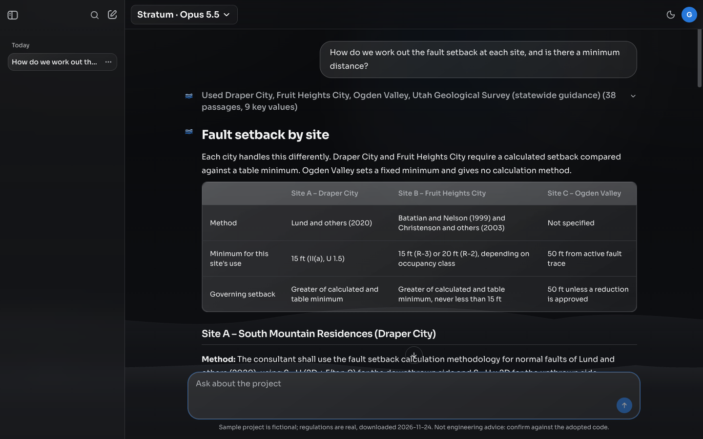
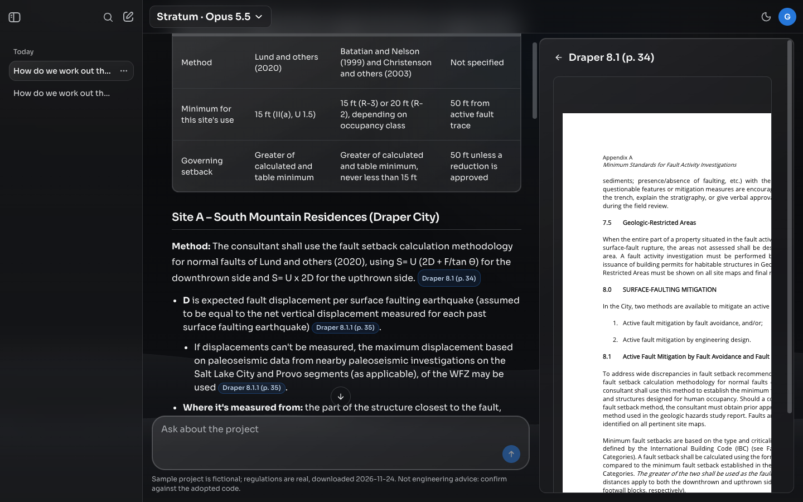

# Stratum

Stratum keeps each local code in its own layer, searches each layer separately, and links the
claims in an answer to the source text they came from.

The sample project is fictional. The regulations are real public documents, downloaded
2026-11-24. This is decision support, not engineering advice: confirm requirements against
the currently adopted code.



## The problem with ordinary RAG

Ordinary retrieval embeds every document into one pool and fetches the passages closest to
the question. The codes here are a hard case for that: the fault-setback clauses in Draper's
standards and in Fruit Heights' are worded almost identically, so passages from different
cities compete for the same few places in the results. The model then sees one city's rule
and not another's, or both without a clear owner. In the evaluation below, the pooled search
most often left a city out or reported its code as missing; less often it attributed a rule
to the wrong city.

Three real differences in the loaded documents show what is at stake:

| | Draper City | Fruit Heights City | Ogden Valley |
|---|---|---|---|
| Fault setback method | Lund and others (2020) formula, vs. a table minimum | Batatian and Nelson (1999) formula, vs. Table A-1; never under 15 ft | Flat 50 ft from an active trace |
| "Active" fault (Wasatch) | Displacement in the past 4,000 radiocarbon years | Holocene (about 10,000 years) | No age given in the loaded code |
| Slope stability factor of safety | 1.5 static, 1.0 pseudostatic, 1.3 temporary | 1.5 static, 1.0 pseudostatic, 1.3 temporary | Not specified in the loaded code |

## How Stratum handles it

1. **The regulation is data, not prose.** Every passage is stored with its regulation, document,
   section path, page and source link. The same header is embedded with the text.
2. **A project maps sites to regulations.** A small routing step (Claude Haiku) reads the
   question and decides which regulations it concerns: "Site B" resolves to Fruit Heights;
   "compare the sites" resolves to all three.
3. **One search per regulation, behind a hard filter.** A Draper passage cannot be returned
   as evidence for Fruit Heights, because the Fruit Heights search never sees it. Statewide
   guidance (Utah Geological Survey) is searched separately and labelled as guidance, not law.
4. **Hybrid search, then re-ranking.** Keyword search catches exact things ("1.5", "Section
   8.1.3", "Lund and others (2020)"); vector search catches meaning. The two are merged and
   re-ranked against the actual question.
5. **Section expansion.** When two parts of one section are found, its remaining parts are
   pulled in too, so a formula arrives with its table of minimums.
6. **Tables are parsed as tables.** Plain PDF text extraction scrambled Draper's setback table
   (values landed on the wrong rows). Cells are read individually and written as
   self-describing rows.
7. **Quote-level citations.** Passages go to Claude as separate cited documents, and the
   statements it cites link to the passage they came from. Citation is done by the model, so
   an uncited sentence is possible. The prompt tells it to say so when a regulation is
   silent instead of borrowing from a neighbour; it did in all four trap questions below.

```
Browser -> Caddy (HTTPS) -> Chainlit app (login, saved chats, mode picker)
                               | shows what was searched; one chip per cited passage,
                               | which opens the source PDF at the cited page
                               v
                          RAG API (FastAPI, private)
             +-----------------+--------------------+
             v                 v                    v
      Router (Haiku)   Postgres + pgvector    Amazon Bedrock
                       vectors, keywords,     Claude Opus 5.5 / Fable 5.2,
                       metadata filters       Titan embeddings, Cohere Rerank
```

Fable 5.2 is supported in the code but switched off in the deployed site, which answers with
Opus 5.5.

## Try the comparison yourself

All three setups answer with the same Claude model, so any difference in the answers comes
from how the documents are found and handed to it.

1. Sign in and open the picker at the top left of the chat. It lists:
   - **Stratum** - the design above.
   - **Baseline · Naive RAG** - one pooled search on the raw question, generic prompt.
   - **Baseline · No retrieval** - the model's memory only.
2. Pick a setup, start a new chat and ask one of the questions below. A setup applies to the
   whole chat, so use a new chat for each setup.
3. Ask the same question, word for word, in the other two setups.
4. Compare the answers against the "correct answer" column. Under each Stratum and Naive
   answer, the "Used ..." line opens to show which sections were searched, and each citation
   chip opens the source PDF at the cited page.



| Ask | Correct answer | Where the baselines went wrong in the evaluation |
|---|---|---|
| What minimum static factor of safety do the regulations for Site C require for slope stability? | Ogden Valley's code gives no number. It only requires the analysis. | No retrieval offered 1.5 as the likely requirement. Naive RAG said Ogden Valley's code was not among the documents. |
| Compare how the required fault setback is determined at each of the three sites. | Draper: Lund and others (2020) against a table minimum. Fruit Heights: Batatian and Nelson (1999) against Table A-1, never under 15 ft. Ogden Valley: flat 50 ft, no formula. | No retrieval gave all three the same statewide formula. Naive RAG got two sites and missed Ogden Valley's 50 ft rule. |
| Does the age cut-off used to decide whether a fault is active differ between Site A and Site B? | Yes. Draper: 4,000 radiocarbon years for the Wasatch fault zone. Fruit Heights: Holocene, about 10,000 years. | No retrieval said they probably do not differ. Naive RAG found Draper's rule and said no Fruit Heights standard was provided. |
| Which published fault setback formula do the regulations for Site C require us to use? | None. Ogden Valley sets a 50 ft minimum, reducible with justification. | Both baselines missed the 50 ft rule. |

Answers are generated fresh each time, so a baseline will sometimes get one of these right.
The pattern to look for across several questions is what matters: one city's rule applied to
another, a general value offered where the code is silent, or a code reported as missing
when it is loaded.

## Results

The set is 19 questions written from the source text: single-regulation facts,
cross-regulation comparisons, "trap" questions where the right answer is "not specified
here", and one report-drafting task. Each answer is graded by a second model call for
correctness and for wrong-regulation errors, and search is checked separately. All three
setups use Claude Opus 5.5; run on 2026-11-25.

| Setup | Correct | Flagged as wrong-regulation | Search found the right section |
|---|---|---|---|
| No retrieval | 16% (3/19) | 42% (8/19) | n/a |
| Naive RAG (one pooled search) | 68% (13/19) | 11% (2/19) | 69% (11/16) |
| Stratum | 100% (19/19) | 11% (2/19), both checked and unfounded | 94% (15/16) |

Correct answers by question type:

| Setup | Single | Compare | Silent | Draft |
|---|---|---|---|---|
| No retrieval | 2/10 | 0/4 | 1/4 | 0/1 |
| Naive RAG | 10/10 | 1/4 | 2/4 | 0/1 |
| Stratum | 10/10 | 4/4 | 4/4 | 1/1 |

How to read this:

- Naive retrieval handled single facts and did poorly on comparisons and traps. Its usual
  failure was leaving a city out or saying that city's code was not provided.
- The grader flagged two Stratum answers about Fruit Heights for details it guessed belonged
  to another city (Table A-1, the Batatian and Nelson method, the Salt Lake City fault
  segment). All of them are in the Fruit Heights documents, so the flags are grader errors.
  They are left in the table as graded. An automated grader is a noisy instrument.
- Before the [requirements matrix](#requirements-matrix) was added, Stratum scored 18/19 with
  no flags. The miss was the drafting task: search did not return Draper's fault-setback
  section, so the draft said the documents were silent on it. Search still misses that
  section (15/16 above); the matrix is what supplies the value now.
- The matrix covers several of the facts these questions ask about, so the 19/19 partly
  reflects that overlap. It shows the lookup works, not that every question is now safe.
- Stratum sends about 70% more input tokens per question than naive retrieval (15,600
  against 9,200).

### Limits of this evaluation

Read the numbers above as a direction, not a benchmark:

- **Small.** 19 questions, and only one of them is a report-drafting task.
- **One run.** Answers vary between runs. In an earlier run of the same baselines, no
  retrieval scored 4/19 and naive RAG was flagged 5 times instead of 2.
- **Graded by a model.** A second Claude call does the grading, and it makes mistakes: both
  flags against Stratum above were wrong. No engineer has graded the answers.
- **Written by the same AI that wrote the system.** Claude wrote the questions and the
  reference answers from the downloaded documents (see
  [How this was built](#how-this-was-built)), and they target the differences this design is
  meant to handle. The reference answers were not checked by an engineer.
- **Overlaps the matrix.** Several questions ask for values the requirements matrix stores.
- **Narrow corpus.** Three local codes and one statewide guideline, all from Utah, on
  geologic hazards. Nothing here shows how it behaves on other codes or more of them.

The full table is in [`eval/results/results.md`](eval/results/results.md) and every answer
with its grade is in [`eval/results/results.json`](eval/results/results.json). Reproduce with
`python /srv/eval/run.py` inside the `rag-api` container.

## What is in the corpus

| Layer | Document | Chunks |
|---|---|---|
| Local | Draper City Geotechnical Engineering Standards (2025-12-16), with Appendices A-E | 145 |
| Local | Fruit Heights City Code Ch. 10.10A (SLEDS) and its appendices | 159 |
| Local | Ogden Valley Code Ch. 108-22, Natural Hazard Areas | 24 |
| State | Utah Geological Survey Circular 128 (2020) | 556 |

Sources and download checks are recorded in [`corpus/sources.yaml`](corpus/sources.yaml) and
[`corpus/provenance.json`](corpus/provenance.json). No paywalled standards are included.

## Requirements matrix

Search can still miss a section, so the few values a report cannot get wrong are not left to
it. `python -m app.ingest.cli matrix` reads each local code in full once and records eight
values per code (fault setback method and minimum, active fault definition, slope stability
factors of safety, seismic coefficient, report validity) in
[`corpus/requirements-matrix.yaml`](corpus/requirements-matrix.yaml), each with the sentence
it came from, its section and page. A cell is kept only if its quote is found word for word
in the source; where a code says nothing, the cell records that. At answer time the routing
step picks which cells the question touches, and those are read from the file and sent with
the searched passages.

What is and is not checked: the extraction is done by Claude. Only the quote is checked
automatically. The one-sentence summary in each cell is the model's wording, and a "not
specified" cell is the model's reading of the full text with nothing to check it against.
None of it has been reviewed by a licensed engineer.

## Running it

Local (needs Docker and AWS credentials with Bedrock access):

```bash
cp deploy/.env.example deploy/.env          # then fill in values (the two logins are set here)
docker compose -f deploy/docker-compose.yml -f deploy/docker-compose.local.yml --env-file deploy/.env up -d --build
docker compose -f deploy/docker-compose.yml -f deploy/docker-compose.local.yml --env-file deploy/.env exec rag-api python -m app.ingest.cli load
docker compose -f deploy/docker-compose.yml -f deploy/docker-compose.local.yml --env-file deploy/.env exec rag-api python -m app.ingest.cli verify
open http://localhost:3000
```

AWS (one small ARM instance, about $30/month at full rate):

```bash
cd infra && pnpm install
npx cdk deploy -c domain=<subdomain> -c adminEmail=<you> -c guestEmail=<guest>
# add a DNS A record for the subdomain pointing at the PublicIp output; HTTPS is automatic
```

`cdk destroy` removes the stack, including the server and the backup bucket. It leaves the
generated passwords in Parameter Store and the container images in the CDK asset repository.
`scripts/redeploy.sh` pushes code changes to the running server.

## Safeguards

- Login required. There is no registration: the only accounts are the two set in the environment,
  and repeated failed sign-ins are throttled.
- A daily token ceiling on the answering model is reserved atomically before each request and
  settled afterwards. The smaller routing, embedding and re-ranking calls are not counted.
- The instance role may invoke only the specific Bedrock models used here.
- Containers cannot reach the server's credential endpoint. Short-lived credentials are handed
  to the retrieval service alone, and the setup script refuses to go live if a check of that fails.
- No SSH; access is through AWS Systems Manager. Secrets are generated on the instance and
  stored encrypted in Parameter Store.
- An AWS Budget emails at 50% and 100% of the monthly limit.

## Layout

```
corpus/            source manifest, sample project, provenance
services/rag-api/  routing, retrieval, generation, ingestion, spend guard
services/chat/     Chainlit frontend: sign-in, saved chats, source viewer, theme
deploy/            Docker Compose stack, HTTPS proxy, server script
infra/             AWS CDK (TypeScript)
eval/              questions, runner, results
```

The chat interface is built on [Chainlit](https://github.com/Chainlit/chainlit) (Apache 2.0).

## How this was built

This project was built by Caleb Wells working with Claude Code, Anthropic's AI coding agent.

- **Caleb Wells** chose the problem and the idea of retrieval over the regulations, set the
  constraints (AWS with CDK, Bedrock, a login, a monthly cost limit), chose Chainlit for the
  interface, and directed the design, wording and scope by reviewing the running app.
- **Claude** proposed the search-per-code design, the two baselines, the evaluation and the
  requirements matrix. It found and downloaded the source documents and wrote the code, the
  infrastructure, the evaluation questions and reference answers, and this README.

No licensed engineer has reviewed the regulatory content, the reference answers or the
requirements matrix.
